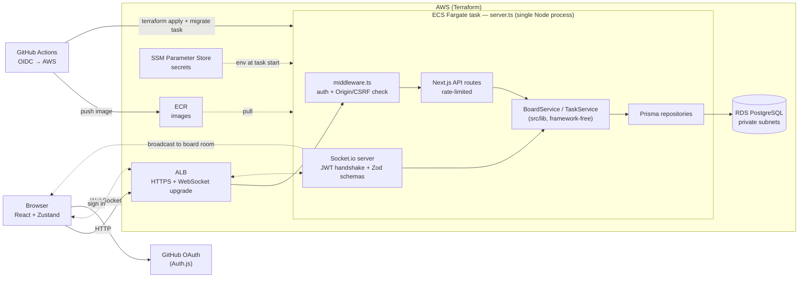

# Valley Sync

[](https://github.com/joshmgrey/Valley-Sync/actions/workflows/ci.yml)

Valley Sync is a real-time collaborative task board where multiple users can create boards, add tasks, and move them across columns — with every change broadcast instantly to all connected clients over WebSockets. Built to demonstrate a production-grade TypeScript architecture: business logic decoupled from the framework behind repository interfaces, end-to-end type-safe Socket.io events, GitHub OAuth via Auth.js, multiple layers of security hardening, and a CI/CD pipeline that runs tests on every PR and push to main, and deploys to AWS whenever a push to main changes the app or infrastructure.

## Tech Stack

- **Framework:** Next.js 14 (App Router, custom Node.js server)
- **Real-time:** Socket.io
- **Database:** PostgreSQL via Prisma ORM
- **Auth:** Auth.js v5 (GitHub OAuth, JWT strategy)
- **State:** Zustand (optimistic updates)
- **Language:** TypeScript
- **Testing:** Jest + React Testing Library
- **CI/CD:** GitHub Actions (OIDC to AWS, no stored keys)
- **Infra:** Terraform — AWS ECS Fargate, RDS PostgreSQL, ALB, ECR, SSM

## Architecture

Business logic lives in `src/lib/` behind repository interfaces, completely decoupled from Next.js. API routes and the Socket.io server are thin layers that call into those services — the same `TaskService` handles both REST and WebSocket mutations.



A task mutation from one client goes `Socket.io → Zod validation → TaskService → Prisma → Postgres`, then the server emits the result to every socket in that board's room. REST mutations hit the same `TaskService`.

```
src/
├── app/
│   ├── api/           # Thin route handlers (boards, tasks)
│   └── boards/[id]/   # Board page (server-rendered initial data)
├── lib/
│   ├── board/         # BoardService + PrismaBoardRepository
│   ├── task/          # TaskService + PrismaTaskRepository
│   ├── socket/        # Socket.io server, auth middleware, Zod schemas
│   └── rateLimit.ts   # In-memory sliding-window rate limiter
├── components/
│   ├── board/         # BoardView, CreateBoardForm
│   ├── task/          # TaskColumn, TaskCard, AddTaskForm
│   └── ui/            # UserNav (avatar + sign-out)
├── hooks/             # useSocket (singleton, wired to Zustand)
├── store/             # boardStore (Zustand)
└── types/             # Shared types + Socket.io event maps
```

## Security

Valley Sync implements several layers of protection:

**Authentication & Authorization**
- All routes and Socket.io connections require a valid Auth.js JWT session.
- Board operations (rename, delete) are restricted to the board's owner — other users receive `403 Forbidden`.

**CSRF Protection**
- All mutating HTTP requests (`POST`, `PATCH`, `DELETE`) are validated against the `Origin` header in `middleware.ts`. Cross-origin mutations are rejected with `403`.

**Input Validation**
- Service layer enforces field constraints: board names ≤ 100 chars, task titles ≤ 200 chars, descriptions ≤ 1 000 chars.
- Socket.io event payloads are parsed through Zod schemas (`src/lib/socket/eventSchemas.ts`) on every inbound event. Invalid payloads are silently discarded rather than crashing the connection.

**Rate Limiting**
- An in-memory sliding-window rate limiter (`src/lib/rateLimit.ts`) limits mutation API routes to 60 requests per user per minute. Excess requests receive `429 Too Many Requests`.

**Socket Authentication**
- The Socket.io `io.use()` middleware decodes the Auth.js JWT cookie on every connection handshake. Unauthenticated connections are rejected before any event handler runs.

## Local Development

**Prerequisites:** Docker, Node.js 20+

**1. Clone and install**
```bash
git clone https://github.com/joshmgrey/Valley-Sync.git
cd Valley-Sync
npm install
```

**2. Configure environment**
```bash
cp .env.example .env
```

In `.env`:

- `DATABASE_URL` already matches the Postgres container in `docker-compose.yml`
  (`valley:valley@localhost:5432/valley_sync`) — leave it unless you changed that file.
- Fill in `AUTH_GITHUB_ID` and `AUTH_GITHUB_SECRET` (see [GitHub OAuth Setup](#github-oauth-setup)).
- Generate `AUTH_SECRET` (next step).

**3. Generate AUTH_SECRET**
```bash
node -e "console.log(require('crypto').randomBytes(32).toString('base64'))"
```
Paste the output into `AUTH_SECRET` in `.env`. (Works in any shell; `openssl rand -base64 32` is equivalent on macOS/Linux.)

**4. Start the database**
```bash
docker compose up -d
```

**5. Run migrations**
```bash
npx prisma migrate dev
```

**6. Start the dev server**
```bash
npm run dev
```

Open [http://localhost:3000](http://localhost:3000).

## GitHub OAuth Setup

1. Go to [github.com/settings/developers](https://github.com/settings/developers) → OAuth Apps → New OAuth App
2. Set **Authorization callback URL** to `http://localhost:3000/api/auth/callback/github`
3. Copy the client ID and generate a client secret
4. Paste both into `.env`

For production, create a second OAuth app whose **Authorization callback URL** is
`https://<SUBDOMAIN>.<DOMAIN_NAME>/api/auth/callback/github`, and store its client
ID/secret as GitHub repo secrets (see [Deployment](#deployment)) — not in `.env`.
The callback host is baked into the build, so it must be decided before the first
deploy.

## Running Tests

```bash
npm test            # or: npm test -- --coverage
```

The suite unit-tests the framework-independent domain layer — `BoardService`
and `TaskService` against mock repositories, plus the Socket.io event schemas
(`src/lib/socket/eventSchemas.ts`). No database required. Coverage is enforced
at 90% (branches/functions/lines/statements) **for those files only**; route
handlers, React components, and the Prisma repositories are thin adapters and
are not part of the coverage gate.

**Current results** (`npm test -- --coverage`):

| Suite | Covers |
|---|---|
| `tests/unit/lib/boardService.test.ts` | `BoardService` — validation, ownership checks |
| `tests/unit/lib/taskService.test.ts` | `TaskService` — create/update/delete, field limits |
| `tests/unit/lib/eventSchemas.test.ts` | Socket.io Zod payload schemas |

3 suites, **44 tests, all passing**. Coverage on the gated files:

| File | Statements | Branches | Functions | Lines |
|---|---|---|---|---|
| `src/lib/board/boardService.ts` | 100% | 100% | 100% | 100% |
| `src/lib/task/taskService.ts` | 100% | 100% | 100% | 100% |
| `src/lib/socket/eventSchemas.ts` | 100% | 100% | 100% | 100% |

## Deployment

Infrastructure is Terraform-managed on AWS: ECS Fargate (one task) behind an
Application Load Balancer with HTTPS and WebSocket support, RDS PostgreSQL in
private subnets, image in ECR, secrets in SSM Parameter Store. Full layout,
one-time bootstrap, cost, and teardown are in
[`deploy/terraform/README.md`](deploy/terraform/README.md).

**Pipeline** (`.github/workflows/ci.yml`) — `test` and `lint` run on every PR and
push to `main`. On a push to `main` that touches deployable paths (`src/`, `server.ts`,
`prisma/`, configs, `package*.json`, `Dockerfile`, `deploy/terraform/`, or the
workflow itself), once they pass, the `deploy` job authenticates to AWS via
GitHub OIDC and:

1. builds the Docker image and pushes it to ECR tagged with the commit SHA
2. runs `terraform apply` (infrastructure + task definitions)
3. runs `prisma migrate deploy` as a one-off ECS task and requires it to exit 0
4. waits for the ECS service to roll onto the new image and reports failure if
   the deployment circuit breaker rolls it back

Pushes that only change docs or tests skip the `deploy` job.

**Required GitHub repo configuration:**

| Kind | Name | Value |
|---|---|---|
| Variable | `AWS_ROLE_ARN` | CI role ARN (from the bootstrap outputs) |
| Variable | `AWS_REGION` | e.g. `us-east-1` |
| Variable | `DOMAIN_NAME` | root domain with a Route53 hosted zone, e.g. `example.com` |
| Variable | `SUBDOMAIN` | host label, e.g. `app` |
| Secret | `AUTH_GITHUB_ID` | production GitHub OAuth app client ID |
| Secret | `AUTH_GITHUB_SECRET` | production GitHub OAuth app client secret |

The app is served at `https://<SUBDOMAIN>.<DOMAIN_NAME>`. `AUTH_SECRET`,
`DATABASE_URL`, `AUTH_URL`, and `NEXT_PUBLIC_APP_URL` are generated by Terraform and injected
from SSM — never set by hand.

## API

All routes require a valid session. Unauthenticated requests return `401`. Requests from other origins return `403`. Mutation routes are rate-limited to 60 req/min per user.

| Method | Path | Description | Auth |
|--------|------|-------------|------|
| `GET` | `/api/boards` | List all boards | Any user |
| `POST` | `/api/boards` | Create a board | Any user |
| `GET` | `/api/boards/:id` | Get a board with tasks | Any user |
| `PATCH` | `/api/boards/:id` | Rename a board | Owner only |
| `DELETE` | `/api/boards/:id` | Delete a board | Owner only |
| `GET` | `/api/tasks?boardId=` | List tasks for a board | Any user |
| `POST` | `/api/tasks` | Create a task | Any user |
| `GET` | `/api/tasks/:id` | Get a task | Any user |
| `PATCH` | `/api/tasks/:id` | Update a task | Any user |
| `DELETE` | `/api/tasks/:id` | Delete a task | Any user |

## Socket Events

Socket connections are authenticated via JWT cookie on the handshake. All inbound payloads are validated with Zod before reaching any handler.

| Direction | Event | Payload |
|-----------|-------|---------|
| Client → Server | `board:join` | `boardId: string` |
| Client → Server | `board:leave` | `boardId: string` |
| Client → Server | `task:create` | `{ boardId, title, status?, description?, assigneeId? }` |
| Client → Server | `task:update` | `{ taskId, changes }` |
| Client → Server | `task:delete` | `{ taskId }` |
| Server → Client | `task:created` | `{ task }` |
| Server → Client | `task:updated` | `{ taskId, changes }` |
| Server → Client | `task:deleted` | `{ taskId }` |
